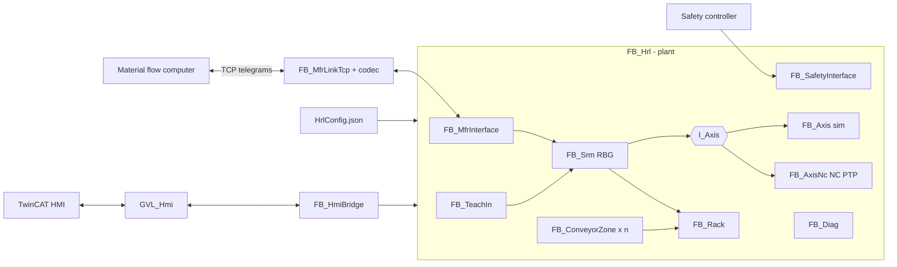

# HRL/RBG control library for TwinCAT 3

**PLC control for a pallet high-bay warehouse: storage and retrieval machine (RBG), rack, conveyor
pre-zone and the telegram interface to the material flow computer, configured per plant instead of
reprogrammed.**

[](https://github.com/sulemanali5760/twincat3-hrl-virtual-commissioning/actions/workflows/plc-project.yml)


The same Structured Text runs on simulated axes for virtual commissioning and on Beckhoff NC axes for
the machine; rack size, axis data, conveyors, MFR link and telegram layout come from one JSON file.
Every function block is covered by TcUnit tests that run on the soft-PLC.

| | |
|---|---|
| **Motion** | `I_Axis` with two implementations: simulated trapezoid profile (`FB_Axis`) and NC PTP (`FB_AxisNc`, MC_Power / MC_MoveAbsolute / MC_Halt) |
| **Configuration** | `HrlConfig.json` from the boot folder (Tc3_JsonXml): rack up to 2 × 60 × 16 places, axes, conveyors, MFR, safety mode; range-checked, rejected as a whole if invalid |
| **MFR interface** | WAMAS-style telegrams (TORD / TACK / TERR / TDON) checked before anything moves; TCP server (Tc2_TcpIp) with configurable fixed-length layout; in-PLC emulator for commissioning |
| **Operation** | automatic, manual jog with fork interlock, homing, stop with resume; guided teach-in with tolerance check |
| **Diagnostics** | fault list with cause and remedy, logged once per edge to the TwinCAT logger |
| **Safety (standard side)** | drive enable, restart lock after every safety drop, door unlock at standstill; TwinSAFE template and EN 528 / EN ISO 13849 checklist in [docs/safety](docs/safety/README.md) |
| **HMI** | TwinCAT HMI (TE2000) operator page bound to one interface GVL |
| **Proof** | 59 TcUnit tests (12 suites) incl. NC axes; FEM 9.851 double cycle measured 51.91 s vs 52.4 s calculated |



It is built on my [NodeTree framework](https://github.com/sulemanali5760/twincat3-pickplace-framework):
the plant is a tree of nodes, one `Cyclic()` on the root runs everything, devices expose commands
that return `eBusy / eDone / eError`, and sequences are a `CASE` over a step manager. The framework is
referenced as the compiled library `NodeTree.library`, not copied.

### ▶ [Watch the plant run in your browser](https://sulemanali5760.github.io/twincat3-hrl-virtual-commissioning/)

No TwinCAT needed. The page is a JavaScript port of the RBG and MFR logic: the RBG stores and
retrieves pallets, the telegram log shows every order and answer, and buttons send the faulty
telegrams from the interface test or fail the travel drive mid-job. (Source: `docs/index.html`.)
## What happens, in plain words

1. A pallet arrives on the **in-feed** conveyor and passes the **I-point** (contour and barcode check). It stops on the **transfer station** in front of the aisle.
2. The **material flow computer** (here an emulator) sends a transport order `TORD`: *take LE0042 from the station to place L-07-3*.
3. The PLC checks the order **before anything moves**: sequence number, duplicate order, valid places, RBG free, source holds exactly that pallet, target empty. If one check fails it answers `TERR` with a status code. If all pass it answers `TACK` and starts the RBG.
4. The **RBG** runs its single cycle: travel and hoist to the station together, fork out, lift, fork in, travel to the place still lifted, fork out, lower, fork in. The rack books the pallet out at "lift" and in at "lower", so the PLC always knows where every pallet is.
5. When the fork is back in the middle, the PLC reports `TDON`. The material flow computer must acknowledge with `TACK` within 5 s, otherwise the PLC raises status 30.
6. After every third store, the emulator orders the oldest pallet back out. The station is held free for it, the RBG brings the pallet to the station, and the out-feed takes it away.

In simulation every axis follows a real speed/acceleration profile, so the times
are realistic: one store or retrieval takes about 25–40 s, a FEM 9.851 double
cycle about 52 s.

## The plant

```
                     rack, left side (20 columns x 8 levels)
   ┌──────────────────────────────────────────────────────────┐
   │ ▢ ▢ ▢ ▢ ▢ ▢ ▢ ▢ ▢ ▢ ▢ ▢ ▢ ▢ ▢ ▢ ▢ ▢ ▢ ▢                  │
in-feed ─▶ [transfer station] ══ RBG aisle ═══════════════════▶  travel x
out-feed ◀─        ▲            hoist y, telescopic fork z
   │ ▢ ▢ ▢ ▢ ▢ ▢ ▢ ▢ ▢ ▢ ▢ ▢ ▢ ▢ ▢ ▢ ▢ ▢ ▢ ▢                  │
   └──────────────────────────────────────────────────────────┘
                     rack, right side            320 places, single-deep
```

| Part | Block | What it does |
|---|---|---|
| Rack | `FB_Rack` | Which place holds which load unit; nominal positions from the drawing; **teach-in** of measured positions with a tolerance check (> 20 mm off = check the rack) |
| Axes | `FB_Axis` ×3 | Travel, hoist, fork. Simulated trapezoid velocity profile (v, a), `lrActPos` stands for the laser distance sensor |
| RBG | `FB_Srm` | Single cycle: travel+hoist → fork out → lift → fork in → travel+hoist → fork out → lower → fork in. Books the pallet out of the source and into the target at the exact step |
| Conveyor | `FB_ConveyorZone` | One **standard block** for every zone of the pre-zone — zones differ only in parameters (length, speed, jam time). Accept / deliver handshake, end light barrier, jam detection |
| I-point | `FB_IPoint` | Contour check (overhang, height) and barcode read before a pallet may be stored |
| MFR interface | `FB_MfrInterface` | Telegrams to the material flow computer (WAMAS-like): checks sequence number, duplicate order, valid addresses, RBG free, source holds the ordered load unit, target free → `TACK` or `TERR` with a status code; reports `TDON` and watches the acknowledgement |
| Throughput | `F_TravelTime`, `F_DoubleCycleTime` | Performance proof after FEM 9.851 (double cycle) |
| Demo | `FB_Hrl`, `FB_MfrEmulator`, `MAIN` | The plant as the root node; an emulated MFR feeds pallets, stores them and after every third store retrieves the oldest, so the plant runs by itself |

## Telegram status codes

| Code | Meaning | | Code | Meaning |
|---|---|---|---|---|
| 0 | OK | | 41 | duplicate order |
| 10 | target place occupied | | 42 | invalid address |
| 11 | source place empty | | 43 | RBG busy |
| 20 | contour NIO | | 44 | wrong load unit at source |
| 30 | TDON not acknowledged in time | | 45 | unknown telegram |
| 40 | sequence number out of order | | 50 | RBG fault |

The real telegram layout of a material flow computer is project-specific; this is a typical fixed layout.

## Performance proof (FEM 9.851 double cycle)

Store at P1, travel empty to P2, retrieve there, back to the transfer station.
FEM 9.851 places the reference points at P1 = (1/5 L, 2/3 H) and P2 = (2/3 L, 1/5 H);
the nearest places in this rack are column 4 / level 6 and column 13 / level 2.

| | |
|---|---|
| Rack L × H | 28.6 m × 9.1 m |
| Axes | travel 3.0 m/s, 0.6 m/s² · hoist 1.5 m/s, 0.8 m/s² · fork 0.6 m/s, 0.6 m/s² |
| Pick or deposit (fork out, lift/lower, fork in) | 6.37 s |
| Moves station → P1 → P2 → station | 6.43 s + 9.17 s + 11.27 s |
| **Calculated double cycle** | **52.4 s ≈ 69 double cycles per hour** |
| **Measured on the soft-PLC** | **51.91 s ≈ 69 double cycles per hour** (run of 14 Nov 2026) |

The test `DoubleCycle_MatchesTheFem9851Calculation` runs the same two jobs on the
simulated RBG and requires the measured time to be within 5 % of the calculation.

## Configuration: what an integrator sets per plant

The plant is built from `HrlConfig.json` in the TwinCAT boot folder
(`C:\ProgramData\Beckhoff\TwinCAT\3.1\Boot\` on 4026). Without the file the
practice plant above runs. Example with every key: [`config/HrlConfig.json`](config/HrlConfig.json).

| Key | What it sets |
|---|---|
| `rack` | sides, columns, levels (up to 2 × 60 × 16), pitches, offsets, fork and lift stroke, teach tolerance |
| `axes.kind` | `sim` = simulated axes, `nc` = Beckhoff NC axes (Tc2_MC2): the same RBG code drives either |
| `axes.travel/hoist/fork` | velocity and acceleration per axis |
| `conveyors.infeed/outfeed` | zone length, speed, jam time, `simulate` or real light barrier |
| `mfr.link` | `emulator` (in-PLC MFR) or `tcp`: the PLC is a TCP server on `mfr.port` |
| `mfr.layout` | field widths of the fixed-length telegram (STX + fields + ETX) |
| `safety.simulate` | bench only; `false` on a real machine (see [docs/safety](docs/safety/README.md)) |

A file that does not parse or holds a value out of range is rejected as a whole;
the defaults stay and the fault list says why.

**Operation and commissioning**: manual mode jogs one axis while a button is held
(travel and hoist only with the fork centred); guided teach-in drives to a place's
nominal position, the operator fine-tunes and confirms, a position further than the
tolerance from the drawing is refused; stop mode halts every axis and the job resumes
in automatic. Faults are written once to the TwinCAT logger with cause and remedy and
kept in an active list for the HMI.

**HMI**: `TcProject/HrlHmi` (TwinCAT HMI, TE2000 14.19). It only uses `GVL_Hmi`
(`stStatus`, `stCommand`), mapped with `{attribute 'TcHmiSymbol.AddSymbol'}`;
`FB_HmiBridge` connects it to the plant. One page: status, operating mode, safety
acknowledge, jog, teach-in, active faults. In *TwinCAT HMI Configuration > Server Symbols > All Symbols*,
map `GVL_Hmi.stStatus` and `GVL_Hmi.stCommand` (right-click > Map Symbol) if they are not listed under
Mapped Symbols; the page binds to `ADS.PLC1.GVL_Hmi.*`.

## Files

Paths relative to `TcProject/HrlRbg/HrlRbgPlc/`.

| Folder | Content |
|---|---|
| `Rack/` | `FB_Rack` (size from config), `ST_SlotAddr`, `ST_Slot`, `GVL_Rack` (defaults and maximum sizes) |
| `Devices/` | `I_Axis`, `FB_Axis` (simulated), `FB_AxisNc` (NC), `FB_ConveyorZone`, `FB_IPoint` |
| `Units/` | `FB_Srm` (automatic, manual jog, homing, stop) |
| `Config/` | `ST_HrlConfig` and parts, `FB_HrlConfig` (file + JSON + range check) |
| `Mfr/` | `FB_MfrInterface`, `I_MfrLink`, `FB_MfrLinkTcp`, `FB_TelegramCodec`, `ST_Telegram`, `GVL_Mfr` |
| `Commissioning/` | `FB_TeachIn` |
| `Diag/` | `FB_Diag`, `E_Fault` |
| `Safety/` | `FB_SafetyInterface`, `ST_SafetyStatus` |
| `Hmi/` | `GVL_Hmi`, `ST_HmiStatus`, `ST_HmiCommand`, `FB_HmiBridge` |
| `Performance/` | travel-time and double-cycle functions |
| `Machine/` | `FB_Hrl`, `FB_MfrEmulator`, `MAIN` |
| `Test/` | TcUnit suites, `PRG_TEST` |

## Tests

59 unit tests with [TcUnit](https://tcunit.org) in 12 suites. Most run their
scenario inside one PLC cycle in simulated time; the two NC tests move real NC
axes (in simulation) and take about 30 s. All 59 pass on TwinCAT 3.1.4026.25
(x64 soft-PLC, run of 18 Nov 2026).

| Suite | What it pins down |
|---|---|
| `FB_Rack_Test` (7) | geometry, teach-in accepted / rejected, booking in and out, no double booking, invalid addresses, next free place |
| `FB_Axis_Test` (5) | arrives in tolerance, trapezoid and triangle move times, drive fault fails the move, reset |
| `FB_AxisNc_Test` (2) | NC axis reaches its target; a whole store job on three NC axes |
| `FB_ConveyorZone_Test` (4) | runs to the light barrier in the right time, one pallet per zone, delivers, jam |
| `FB_IPoint_Test` (3) | OK, overhang, no read |
| `FB_MfrInterface_Test` (10) | the interface test cases: valid order, wrong sequence, duplicate, target occupied, source empty, wrong load unit, invalid address, busy, TDON + ack timeout, TACK |
| `FB_TelegramCodec_Test` (7) | wire format, round trip, wrong length, letter in a number field, custom layout, answer over a link, bad frame answered with TERR 45 |
| `FB_HrlConfig_Test` (5) | valid file, value out of range rejected whole, empty object = defaults, not JSON, a 10 × 4 rack from config |
| `FB_Srm_Test` (5) | store job, retrieve job, refused job, travel fault mid-job keeps the pallet booked, FEM 9.851 double cycle |
| `FB_Operation_Test` (5) | jog while held, jog blocked with the fork out, teach-in stored / refused, stop and resume, fault raised once per edge |
| `FB_SafetyInterface_Test` (3) | no enable after power-up without acknowledge, every safety bit drop locks until reset, door unlock only at standstill |
| `FB_TravelTime_Test` (3) | trapezoid, triangle, zero distance |

## Run it

1. Install two libraries once, each with *PLC → Library Repository → Install*:
   `NodeTree.library` from the [framework releases](https://github.com/sulemanali5760/twincat3-pickplace-framework/releases)
   and `TcUnit.library` from the [TcUnit releases](https://github.com/tcunit/TcUnit/releases).
2. Open `TcProject/HrlRbg.sln` in TwinCAT XAE, platform *TwinCAT RT (x64)*. The NC axes need a
   TF5000 licence (7-day trial: *SYSTEM → License → Manage Licenses*).
3. Optional: copy `config/HrlConfig.json` to the boot folder and edit it.
4. Build, *Activate Configuration*, Run. `PRG_TEST` runs after `MAIN`.
5. Headless (no XAE window): `tools/tc_build_test.ps1` builds `HrlRbg.Plc.sln`, activates it on the
   local runtime and prints the TcUnit result.

Built against TwinCAT 3.1.4026.

## What is verified, and how

- **Compiles**: the whole project, tests included, builds with 0 errors on
  TwinCAT 3.1.4026.25 with TcUnit 1.3.1 (headless build through the Automation
  Interface, 18 Nov 2026).
- **Tests run**: 59 of 59 pass on the local runtime, read from TcUnit's xUnit
  result file; the NC tests run on NC simulation axes.
- **Config file**: a real `HrlConfig.json` was loaded from the boot folder on the
  runtime (one-off test, not in the suite because it needs the file).
- **Plant + HMI bridge**: read over ADS on the running PLC: automatic mode, store
  and retrieve jobs counting up, `GVL_Hmi.stStatus` filled.
- **Calculated double cycle**: the 6.37 s / 6.43 s / 9.17 s / 11.27 s / 52.4 s
  figures above were recomputed outside TwinCAT and agree to 0.01 s.
- **CI** (`.github/check_plc_project.py`): every object file is well-formed,
  listed in the project, named like its file. GitHub cannot run TwinCAT, so CI
  does not compile or run the tests.

## Scope and limits

- **Not run on real hardware.** Axes run in NC simulation, light barriers and the MFR are simulated.
- **TCP link to a real MFR**: built and its logic tested (codec, answers over a link double); the socket
  itself has not talked to a client yet (needs a TF6310 licence).
- **Safety is a template**: the standard-PLC side is implemented and tested, the safety function itself
  belongs in a safety controller and must be validated per machine ([docs/safety](docs/safety/README.md)).
- **HMI**: one operator page; checked in the TwinCAT HMI Live-View against the running PLC (values update,
  defaults from the PLC appear in the inputs). Button actions were not clicked through in that check.
- **Teach-in positions are not saved yet** and are lost on a restart.
- **Diagnostics** use the TwinCAT logger (`ADSLOGSTR`), not EventLogger event classes.
- Single-deep, one RBG, one aisle; Beckhoff only.
- The FEM 9.851 reference points are taken as P1 = (1/5 L, 2/3 H), P2 = (2/3 L, 1/5 H); check against the standard text before using the numbers for a real acceptance.
